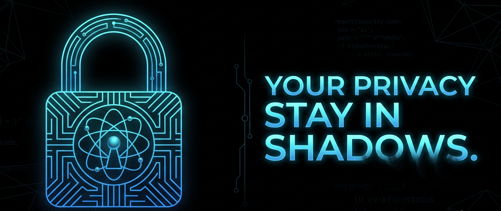

<p align="center">
  
</p>

<h1 align="center">Ombracrypt CLI</h1>

<p align="center">
  <strong>Offline Post-Quantum Hybrid Cryptographic Vault for the Terminal</strong>
</p>

<p align="center">
  
  
  <a href="LICENSE"></a>
</p>


---

## Executive Summary

**Ombracrypt CLI** is a local-first, zero-escrow post-quantum cryptographic vault engineered for terminal environments, automation scripts, and headless servers. It protects directory archives against contemporary interception and "Harvest Now, Decrypt Later" (HNDL) quantum attacks. 

Operating offline with **zero telemetry, no cloud dependencies, and zero key custody**, Ombracrypt CLI maintains **100% bit-for-bit wire-format parity** with the [Ombracrypt Desktop Application](https://github.com/ABiswasDev/Ombracrypt). Vaults (`.obv`) and keys (`.obp`/`.obk`) created in the CLI can be authenticated and extracted in the GUI, and vice versa.

---
 
## Key Architectural Capabilities

* **Dual-Profile Post-Quantum Hybrid KEM:**
  * **Profile 1: X-Wing (Default):** Combines NIST FIPS 203 ML-KEM-768 with classical RFC 7748 X25519 using official IETF draft domain separators (`\.//^\`), SHAKE256 seed expansion, and SHA3-256 combiners.
  * **Profile 2: Cypherpunk:** High-security profile combining NIST FIPS 203 ML-KEM-1024 with classical X25519.
* **Folder-Centric In-Memory Streaming:** Streams directory trees directly through bounded in-process buffers in chunks up to $1\text{ MiB}$. Eliminates unencrypted intermediate TAR staging archives on disk during encryption.
* **Cryptographic Artifact Separation:**
  * `.obv` **(Encrypted Vault):** Authenticated ciphertext stream bound to header metadata via Additional Authenticated Data (AAD).
* `.obk` **(Private Decapsulation Key):** Offline decapsulation key generated with `0600` owner-only permissions.
    * **X-Wing profile:** Exactly **86 bytes** (5 B magic + 1 B kem_id + 16 B salt + 32 B seed + 32 B phantom block).
    * **Cypherpunk profile:** Exactly **3,254 bytes** (5 B magic + 1 B kem_id + 16 B salt + 3,168 B ML-KEM-1024 d<sub>k</sub> + 32 B X25519 s<sub>k</sub> + 32 B phantom block).
  * `.obp` **(Public Sealing Key):** Reusable public key allowing one-way vault encryption for individual or group recipients without granting decryption rights (1,222 bytes for `xwing`, 1,606 bytes for `cypherpunk`).
* **Cooperative Signal Cancellation & Atomic Rollback:** Intercepts operating system termination signals non-blockingly via `ctrlc` and an atomic cancellation barrier.
  * **Unix (Linux/macOS):** Handles `SIGINT` (Ctrl+C), `SIGTERM`, and `SIGHUP` via `ctrlc`'s `termination` feature.
  * **Windows:** Handles Console Control Events (`CTRL_C_EVENT`, `CTRL_CLOSE_EVENT`).
  * In-flight staging directories (`.ombracrypt_stage_*`) and incomplete `.part` files undergo atomic staging rollback and directory removal before process exit. Uncatchable interruptions (`SIGKILL`, sudden power failure) are safely recovered at any time via `ombracrypt clean`.
* **Interactive Duress Response:** Entering a secondary deception passcode during decryption triggers an in-place CSPRNG overwrite against the target `.obk` key file on disk (enforcing `st_nlink > 1` protection) and returns a generic authentication failure, rendering the private key unrecoverable. On solid-state media with hardware wear-leveling, this provides an immediate application-level cryptographic overwrite.
* **Defensive Filesystem Architecture:** Pre-flight storage telemetry via `fs2`, collision-proof atomic publication (`atomic_publish_noreplace` and `atomic_publish_dir_noreplace`), advisory sentinel file locks (`.active.lock`), and defensive TAR parsing limits (zip-slip sanitization, anti-symlink traversal, recursion depth ceilings $\le 64$).
* **Scriptable & CI-Ready:** Supports both interactive masked terminal prompts (`inquire`) and non-interactive inputs (`--password-env`, `--password-file`, or standard input pipe), strictly preserving all intentional passphrase whitespace while stripping only line terminators (`\r`, `\n`).
* **Memory Zeroization:** All plaintext buffers, intermediate decapsulation keys, and credential strings are encapsulated in `zeroize::Zeroizing` wrappers and wiped immediately upon drop.

---

## Download & Installation

Pre-compiled standalone binaries are available from [GitHub Releases](https://github.com/ABiswasDev/ombracrypt-cli/releases):

| Platform | Architecture | Binary Package |
| :--- | :--- | :--- |
| **Linux** | x86_64 | `ombracrypt-v2.0.0-linux-x64.tar.gz` |
| **macOS** | Apple Silicon (aarch64) | `ombracrypt-v2.0.0-macos-arm64.tar.gz` |
| **macOS** | Intel (x86_64) | `ombracrypt-v2.0.0-macos-x64.tar.gz` |
| **Windows** | x86_64 | `ombracrypt-v2.0.0-windows-x64.zip` |

### Linux & macOS Quick Setup

```bash
# Extract the binary
tar -xvf ombracrypt-v2.0.0-linux-x64.tar.gz

# Make executable and install to system PATH
chmod +x ombracrypt
sudo mv ombracrypt /usr/local/bin/

# Verify installation
ombracrypt --version
```

### Windows Quick Setup
Extract `ombracrypt.exe` from the zip archive and place it in your `PATH` or invoke it directly:
```powershell
.\ombracrypt.exe --version
```

---

## CLI Command Reference

```plaintext
Usage: ombracrypt <COMMAND>

Commands:
  encrypt  Encrypt a directory into a Quantum-Safe Vault (.obv)
  decrypt  Decrypt a Quantum-Safe Vault (.obv) using your Private Key (.obk)
  keygen   Generate a standalone reusable Keypair (.obp Public Key + .obk Private Key)
  clean    Reclaim and purge orphaned Ombracrypt staging directories (.ombracrypt_stage_*)
  inspect  Pre-flight disk space telemetry and path conflict assessment
  help     Print this message or the help of the given subcommand(s)
```

---

### 1. `encrypt` (Lock Vault)

Encrypts a target directory into a post-quantum authenticated vault (`.obv`). By default, it generates a fresh keypair (`.obp` + `.obk`) or seals directly against an existing recipient Public Key (`--public-key`).

```bash
# Interactive encryption with new keypair (defaults to X-Wing + XChaCha20-Poly1305)
ombracrypt encrypt --target "/data/confidential_dir"

# Encrypt and specify custom output directories
ombracrypt encrypt \
  --target "/data/confidential_dir" \
  --output-dir "/backups" \
  --key-dir "/keys"

# One-way sealing to an existing Public Key (no .obk generated)
ombracrypt encrypt \
  --target "/data/reports_dir" \
  --public-key "/keys/alice.obp" \
  --output-dir "/backups"

# Specify Cypherpunk KEM (ML-KEM-1024) and AES-256-GCM cipher
ombracrypt encrypt \
  --target "/data/confidential_dir" \
  --kem cypherpunk \
  --cipher aes256gcm
```

**Options:**
* `-t, --target <PATH>`: Path to the target directory to encrypt. *(Required; must be an existing directory)*
* `-o, --output-dir <DIR>`: Output directory for the `.obv` vault. *(Defaults to parent of target)*
* `-k, --key-dir <DIR>`: Destination folder for generated keys. *(Defaults to output directory)*
* `-p, --public-key <FILE>`: Path to existing recipient `.obp` Public Key.
* `-c, --cipher <CIPHER>`: Symmetric cipher: `xchacha20` *(default)* or `aes256gcm`.
* `-m, --kem <PROFILE>`: Post-quantum profile: `xwing` *(default, ML-KEM-768)* or `cypherpunk` *(ML-KEM-1024)*.
* `--password-file <FILE>`: Read Master Password from file.
* `--password-env <VAR>`: Read Master Password from custom environment variable.
* `--deception-passcode-file <FILE>`: Read Deception Passcode from file.
* `--deception-passcode-env <VAR>`: Read Deception Passcode from custom environment variable.
* `-q, --quiet`: Suppress interactive banner and progress displays.

---

### 2. `decrypt` (Unlock Vault)

Authenticates and extracts an `.obv` vault directly in memory using the corresponding `.obk` Private Key and Master Password.

```bash
# Interactive decryption
ombracrypt decrypt \
  --target "/backups/confidential.obv" \
  --key "/keys/confidential.obk"

# Decrypt into a specific destination directory
ombracrypt decrypt \
  --target "/backups/confidential.obv" \
  --key "/keys/confidential.obk" \
  --output-dir "/restore"
```

**Options:**
* `-t, --target <FILE>`: Path to the `.obv` vault file. *(Required)*
* `-k, --key <FILE>`: Path to the `.obk` Private Key file. *(Required)*
* `-o, --output-dir <DIR>`: Directory where extracted contents should be published. *(Defaults to parent of vault)*
* `--password-file <FILE>`: Read Master Password from file.
* `--password-env <VAR>`: Read Master Password from environment variable.
* `-q, --quiet`: Suppress interactive output.

---

### 3. `keygen` (Generate Standalone Keypairs)

Generates standalone reusable keypairs (`.obp` Public Key + `.obk` Private Key with optional Duress Trapdoor).

```bash
# Generate X-Wing keypair (bob.obp + bob.obk)
ombracrypt keygen --name "bob" --output-dir "/keys"

# Generate Cypherpunk keypair (ML-KEM-1024)
ombracrypt keygen --name "carol" --output-dir "/keys" --kem cypherpunk
```

**Options:**
* `-n, --name <NAME>`: Base filename stem for the keypair. *(Required)*
* `-o, --output-dir <DIR>`: Destination directory. *(Defaults to current directory)*
* `-m, --kem <PROFILE>`: `xwing` *(default)* or `cypherpunk`.
* `--deception-passcode-file <FILE>`: Optional duress passcode from file.
* `--deception-passcode-env <VAR>`: Optional duress passcode from environment variable.

---

### 4. `inspect` (Pre-Flight Assessment)

Performs pre-flight storage capacity, path collision, and key verification checks before running operations.

```bash
# Human-readable storage check
ombracrypt inspect --mode encrypt --target "/data/vault_dir" --output-dir "/backups"

# Machine-readable JSON output for automation scripts
ombracrypt inspect --mode encrypt --target "/data/vault_dir" --output-dir "/backups" --json
```

---

### 5. `clean` (Staging Cleanup)

Scans target directories for interrupted or orphaned `.ombracrypt_stage_*` temporary staging remnants and reclaims disk space. Accepts directory and file paths with automatic parent resolution, canonicalization, and deduplication.

```bash
# Clean current directory
ombracrypt clean

# Clean multiple directories simultaneously
ombracrypt clean -d "/backups" -d "/mnt/coldstorage" -d "/var/data"
```

---

## Headless Automation & CI Scripting

For unattended automation, shell scripts, or CI/CD pipelines, credentials can be piped via standard input or supplied via environment variables without interactive prompts. Leading and trailing passphrase whitespace is strictly preserved (only line endings are stripped):

### Example: Automated Backup Script
```bash
#!/usr/bin/env bash
set -euo pipefail

export OMBRACRYPT_PASSWORD="SecureSystemPassword2026!"
export OMBRACRYPT_DECEPTION_PASSCODE=""

ombracrypt encrypt \
  --target "/var/data_backup" \
  --output-dir "/mnt/coldstorage" \
  --quiet

echo "Quantum backup published successfully."
```

### Example: Sealing via Standard Input Pipe
```bash
echo -n "MyMasterPassword" | ombracrypt encrypt \
  --target "/opt/database_dump_dir" \
  --public-key "/keys/auditor.obp" \
  --output-dir "/opt/export" \
  --quiet
```

---

## Cryptographic Artifacts Overview

| Extension | Artifact Role | Internal Structure & Format |
| :--- | :--- | :--- |
| **`.obv`** | Encrypted Vault | Magic bytes `OMBV\x02`, cipher ID, KEM ID, Argon2id parameters ($64\text{ MiB}$, $3\text{ passes}$, $4\text{ lanes}$), salt, nonce, KEM ciphertext payload, and $1\text{ MiB}$ chunked AEAD ciphertext blocks with authenticated end-of-stream tags. |
| **`.obk`** | Private Decapsulation Key | Magic bytes `OBSK\x02`, profile ID, duress salt ($16\text{ B}$), private KEM material, static X25519 private key, and $32\text{-byte}$ phantom duress block. Exactly **86 bytes** for X-Wing (`xwing`) and **3,254 bytes** for Cypherpunk (`cypherpunk`). Restricted to `0600` permissions. |
| **`.obp`** | Public Sealing Key | Magic bytes `OBPK\x02`, profile ID, ML-KEM public encapsulation key, and static X25519 public key. Exactly **1,222 bytes** for X-Wing and **1,606 bytes** for Cypherpunk. |

---

## Building from Source

Ombracrypt CLI has no web frontend or desktop dependencies. It builds with standard Rust tooling:

```bash
# Clone the repository
git clone https://github.com/ABiswasDev/ombracrypt-cli.git
cd ombracrypt-cli

# Run compilation check
cargo check --all-targets

# Run the 60-test security and regression conformance suite (61 on Windows)
cargo test --release -- --nocapture

# Compile the release binary
cargo build --release
```

The optimized executable is output to `target/release/ombracrypt`.

---

## Project Structure

```plaintext
ombracrypt-cli/
├── Cargo.toml                # Zero-Tauri Rust configuration (fips203, x25519-dalek, fs2, libc)
├── LICENSE                   # Cryptographic Autonomy License 1.0 (CAL-1.0)
├── README.md                 # Technical documentation and CLI manual
├── .github/
│   └── workflows/
│       ├── ci.yml            # Multi-OS test & conformance matrix (Linux, macOS, Windows)
│       └── release.yml       # Automated cross-platform release pipeline with SHA-256 checksums
├── docs/
│   └── QUICKSTART.md         # Operational and troubleshooting guide
├── tests/
│   ├── fixtures/             # Independent specification reference vectors (KAT) & Desktop v2
│   └── interop_tests.rs      # Cross-application interoperability test suite
└── src/
    ├── lib.rs                # Library module exports
    ├── main.rs               # Clap CLI definitions, subcommand routers, and progress bars
    ├── crypto.rs             # FIPS 203 ML-KEM, X-Wing combiner, Argon2id KDF, zeroization
    ├── stream.rs             # In-memory chunked AEAD streaming engine and header authentication
    ├── fs_guard.rs           # Atomic publication, advisory sentinel locks, path traversal defense
    ├── deception.rs          # Duress trapdoor protocol and CSPRNG .obk overwrite engine
    ├── pipeline.rs           # On-the-fly streaming encryption/decryption workflows
    └── tests.rs              # Unit, regression, and KAT cryptographic tests
```

---

## Security Invariants & Threat Model

* **In Scope:**
  * Quantum cryptanalysis resistance (NIST FIPS 203 ML-KEM + Classical RFC 7748 X25519).
  * Defense against "Harvest Now, Decrypt Later" (HNDL) adversary collection.
  * In-transit ciphertext manipulation, chunk reordering, and truncation detection (per-chunk counter framing & AAD header binding).
  * Interactive duress response (Plausible Deniability via `.obk` CSPRNG destruction).
  * Protection against Zip-Slip, path traversal, symlink attacks, and malicious TAR entry injection.
* **Out of Scope:**
  * Compromised host kernels, hardware keyloggers, or malicious hypervisors.
* **Zero Recovery Escrow:**
  * Ombracrypt maintains no administrative backdoor or key-escrow service. Loss of the `.obk` private key or Master Password results in irreversible data loss.

For detailed cryptographic proofs and calculations, consult the [Ombracrypt Cryptographic Specification](https://github.com/ABiswasDev/Ombracrypt/blob/main/docs/CRYPTOGRAPHY.md).

---

## Authorship & Copyright

**Ombracrypt CLI** is developed and maintained by **Abhishek Biswas** ([@ABiswasDev](https://github.com/ABiswasDev)).

Official release under **[Ombraveil](https://www.linkedin.com/company/ombraveil/)**, an open-source initiative dedicated to advancing post-quantum cryptography and local data sovereignty.

**Copyright:**  
Copyright © 2026 Abhishek Biswas (Ombraveil). All rights reserved.

---

## License

This project is licensed under the **Cryptographic Autonomy License 1.0 (CAL-1.0)**. See [LICENSE](LICENSE) for details.